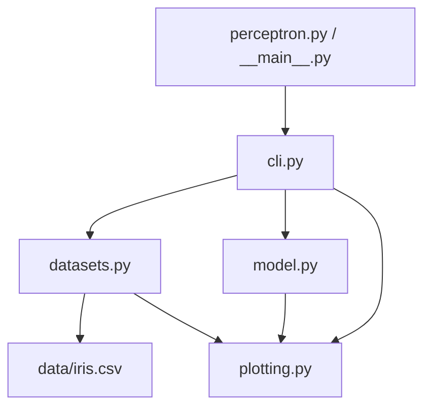

# Перцептрон: бинарная классификация на Python

Учебный проект, в котором простой перцептрон реализован с помощью списков, циклов и арифметики Python. Программа обучается различать два класса, оценивает точность и сохраняет графики границы решения и ошибок по эпохам.

Поддерживаются два набора данных: случайные двумерные точки и локальная копия Iris. В синтетическом наборе центры классов находятся в **(−3, −3)** и **(3, 3)**.

Вычисления перцептрона находятся в классе `Perceptron`. Matplotlib используется для визуализации. Готовые классификаторы, NumPy и scikit-learn в собственном коде алгоритма не используются. При установке Matplotlib его зависимости, включая NumPy, могут устанавливаться автоматически.

## Содержание

- [Быстрый запуск](#быстрый-запуск)
- [Что такое перцептрон](#что-такое-перцептрон)
- [Как проходит обучение](#как-проходит-обучение)
- [Методы класса Perceptron](#методы-класса-perceptron)
- [Данные и их подготовка](#данные-и-их-подготовка)
- [Архитектура и файлы проекта](#архитектура-и-файлы-проекта)
- [Параметры командной строки](#параметры-командной-строки)
- [Результаты и графики](#результаты-и-графики)
- [Библиотеки и средства Python](#библиотеки-и-средства-python)
- [Окружение и зависимости](#окружение-и-зависимости)
- [Тесты и проверки качества](#тесты-и-проверки-качества)
- [Непрерывная интеграция GitHub Actions](#непрерывная-интеграция-github-actions)
- [Кеши и служебные файлы](#кеши-и-служебные-файлы)
- [Ограничения и сложность](#ограничения-и-сложность)


## Быстрый запуск

Нужны Python 3.12 или новее и [uv](https://docs.astral.sh/uv/getting-started/installation/). Для повторяемого запуска и соответствия CI рекомендуется Python 3.12.

Откройте терминал в корне проекта — в папке, где находятся `pyproject.toml`, `uv.lock` и `perceptron.py`.

Установите окружение и зависимости:

```bash
uv sync --frozen --python 3.12
```

Запустите обучение на синтетических данных:

```bash
uv run python -B perceptron.py --samples 200 --lr 0.1 --epochs 50
```

Отдельно запустите обучение на Iris:

```bash
uv run python -B perceptron.py --dataset iris
```

Каждый запуск обучает новую модель только на выбранном наборе. Чтобы получить результаты для обоих наборов, выполните обе команды.


Программа выводит размер выборок, точность, веса, смещение, историю ошибок и путь к графикам. Графики сохраняются на диск; отдельное окно не открывается.

## Что такое перцептрон

Перцептрон — модель машинного обучения для классификации. В этом проекте он относит объект к одному из двух классов: `0` или `1`.

**Объект** — один пример. **Признаки** — числа, описывающие объект. **Метка** — правильный класс, известный для обучающего примера.

Для синтетических данных признаки — координаты точки. Для Iris — длина и ширина лепестка в сантиметрах.

Данные хранятся в двух списках:

```python
X = [[-3.0, -3.0], [3.0, 3.0]]
y = [0, 1]
```

`X[i]` содержит признаки объекта, а `y[i]` — его метку. Порядок должен совпадать: нельзя отдельно перемешать `X` и `y`.

### Веса и смещение

Для каждого признака модель хранит вес. Вес определяет вклад признака в итоговую сумму. Смещение `bias` позволяет перемещать границу решения относительно начала координат.

Для двух признаков модель вычисляет:

$$
z = w_1x_1 + w_2x_2 + b.
$$

Здесь `x₁`, `x₂` — признаки; `w₁`, `w₂` — веса; `b` — смещение.

Затем пороговая функция возвращает класс:

$$
\hat y = \begin{cases}
1, & z \geq 0,\\
0, & z < 0.
\end{cases}
$$

Например, при `w = [0.2, 0.1]`, `bias = -0.1` и `x = [3, 3]`:

```text
z = 0.2 × 3 + 0.1 × 3 − 0.1 = 0.8
prediction = 1
```

Ответ `1` означает класс, а не вероятность. Модель не выдаёт степень уверенности.

### Граница решения

Граница проходит там, где взвешенная сумма равна нулю:

$$
w_1x_1 + w_2x_2 + b = 0.
$$

При двух признаках это прямая. Если `w₂ ≠ 0`, её можно записать как:

$$
x_2 = -\frac{w_1x_1+b}{w_2}.
$$

Именно эта формула используется при построении графика. Если `w₂ = 0`, но `w₁ ≠ 0`, граница вертикальная: `x₁ = −b / w₁`. Если оба веса равны нулю, единственной прямой границы нет, поэтому код её не рисует.

## Как проходит обучение

Обучение относится к **обучению с учителем**: модель получает признаки и правильные метки, сравнивает их со своими ответами и исправляет параметры.

1. Установить веса и смещение в ноль.
2. Взять обучающий объект и получить предсказание.
3. Найти ошибку: `error = target - prediction`.
4. При ненулевой ошибке обновить веса и смещение.
5. Повторить для всех обучающих объектов. Один полный проход называется эпохой.
6. Сохранить количество ошибок за эпоху.
7. Если ошибок нет, закончить обучение. Иначе перейти к следующей эпохе, пока не достигнут заданный предел.

Ошибка может принимать три значения:

- `0` — ответ правильный, параметры остаются прежними;
- `1` — модель выдала `0` вместо `1`;
- `−1` — модель выдала `1` вместо `0`.

Правило обновления:

$$
w_j \leftarrow w_j + \eta\,(y-\hat y)\,x_j,
$$

$$
b \leftarrow b + \eta\,(y-\hat y).
$$

`η` — положительный шаг обучения (`learning_rate`). Каждая поправка зависит от ошибки и значения признака. Параметры меняются сразу после ошибочного ответа: следующий объект уже обрабатывается с новыми весами.

### Один шаг вручную

Пусть `x = [-3, -3]`, правильный класс `0`, веса `[0, 0]`, смещение `0`, шаг `0.1`.

```text
z = 0 × (−3) + 0 × (−3) + 0 = 0
prediction = 1, потому что z >= 0
error = 0 − 1 = −1

w₁ = 0 + 0.1 × (−1) × (−3) = 0.3
w₂ = 0 + 0.1 × (−1) × (−3) = 0.3
b  = 0 + 0.1 × (−1) = −0.1
```

После обновления для той же точки получится `z = −1.9`, то есть класс `0`. Для точки `[3, 3]` получится `z = 1.7`, то есть класс `1`.

Это пример с точками ровно в центрах. Реальные случайные точки имеют небольшой разброс, поэтому численные веса запуска будут отличаться.

## Методы класса Perceptron

Все обязательные методы находятся в `perceptron_lab/model.py`.

### `__init__(n_features, learning_rate=0.1, epochs=50)`

Создаёт модель и сохраняет настройки:

- `w` — список нулевых весов длины `n_features`;
- `bias` — нулевое смещение;
- `learning_rate` — шаг обучения;
- `epochs` — максимальное число эпох;
- `errors_history` — изначально пустая история ошибок.

Проверки запрещают неположительное число признаков и эпох, а также неположительный или неконечный шаг обучения. `math.isfinite()` отсекает `NaN` и бесконечность.

**Смысл проверок:** отклонить настройки, при которых обучение не имеет предусмотренного программой смысла. Аннотации `int` и `float` сами по себе не преобразуют и не проверяют аргументы во время вызова.

### `activate(z)`

```python
return 1 if z >= 0 else 0
```

Преобразует числовую сумму в класс. Равенство нулю относится к классу `1`, поэтому первоначальная модель с нулевыми весами предсказывает `1` для любого обычного конечного входа.

### `predict(x)`

```python
z = self.bias
for weight, value in zip(self.w, x, strict=True):
    z += weight * value
return self.activate(z)
```

Начинает со смещения, прибавляет произведения весов на признаки и применяет `activate`. Веса при предсказании не меняются.

`zip(..., strict=True)` связывает каждый вес с соответствующим признаком и вызывает `ValueError` при разной длине списков. Без `strict=True` лишние элементы могли бы молча пропасть из вычисления.

### `train(X, y)`

Проверяет, что выборка непустая, число объектов совпадает с числом меток, а метки равны `0` или `1`. Затем сбрасывает веса, смещение и историю и выполняет обучение по описанному правилу.

Главная часть изменения параметров:

```python
error = target - self.predict(x)
if error != 0:
    for j in range(len(self.w)):
        self.w[j] += self.learning_rate * error * x[j]
    self.bias += self.learning_rate * error
    errors += 1
```

**Смысл `if error != 0`:** исправлять модель только при ошибочном ответе. Это решение алгоритма, а не проверка корректности входных данных.

В конце каждой эпохи выполняется:

```python
self.errors_history.append(errors)
if errors == 0:
    break
```

Ноль означает, что весь проход выполнен без ошибок и без изменений весов. Для всех обучающих объектов текущие ответы правильные, поэтому дальнейшие эпохи не нужны.

`train()` возвращает `None`: результат хранится в изменённых атрибутах модели. Повторный вызов начинает обучение заново. Перемешивания объектов внутри эпох нет.

### `score(X, y)`

Считает долю правильных предсказаний:

$$
\operatorname{accuracy} = \frac{\text{число правильных ответов}}{\text{число объектов}}.
$$

Например, `27 / 30 = 0.9`, или `90%`. Метод возвращает число от `0` до `1`, а CLI форматирует его как процент.

Проверка непустой выборки предотвращает деление на ноль. Проверка длин не позволяет сравнивать разное количество объектов и меток. `score()` использует `predict()` и не обучает модель.

### Пример использования без CLI

```python
from perceptron_lab.model import Perceptron

X = [[-3.0, -3.0], [3.0, 3.0]]
y = [0, 1]

model = Perceptron(n_features=2, learning_rate=0.1, epochs=50)
model.train(X, y)

print(model.predict([-3.0, -3.0]))
print(model.predict([3.0, 3.0]))
print(model.score(X, y))
```

Для этих примеров вывод будет `0`, `1`, `1.0`. Такая проверка показывает работу на обучающих примерах; для оценки на новых объектах нужна тестовая выборка.

## Данные и их подготовка

`perceptron_lab/datasets.py` подготавливает входные данные. Модель в этом файле не обучается.

### Контейнер Dataset

```python
@dataclass
class Dataset:
    X: list[list[float]]
    y: list[int]
```

`Dataset` объединяет признаки и метки. `@dataclass` автоматически создаёт конструктор и некоторые стандартные методы, например представление объекта. Он не проверяет типы элементов и длины списков автоматически.

### Синтетические точки: центры −3 и 3

`make_synthetic(samples=200, seed=42)` создаёт двумерные точки. Первые `samples // 2` получают класс `0`, остальные — класс `1`. При нечётном количестве объектов класс `1` содержит на один объект больше.

В используемой версии центр задаётся так:

```python
center = -3 if label == 0 else 3
X.append([center + rng.uniform(-0.75, 0.75) for _ in range(2)])
```

Для каждой из двух координат независимо добавляется равномерное случайное отклонение:

- класс `0`: центр `(−3, −3)`, каждая координата в диапазоне `[−3.75, −2.25]`;
- класс `1`: центр `(3, 3)`, каждая координата в диапазоне `[2.25, 3.75]`.

Получаются два квадратных облака точек. У класса `0` обе координаты отрицательные, у класса `1` — положительные. Эти данные линейно разделимы: например, прямая `x₁ + x₂ = 0` разделяет классы.

**Изменение центров с −2/2 на −3/3** увеличивает расстояние между облаками при прежнем разбросе. Формула обучения, метки, интерфейс модели и схема разбиения остаются прежними. Конкретные обученные веса могут измениться, потому что значения признаков входят в поправку.

Проверка `samples < 8` запрещает слишком маленький синтетический набор. Это выбранное ограничение генератора, а не математическое требование перцептрона.

### Iris

`load_iris()` читает `perceptron_lab/data/iris.csv`. CSV уже включён в проект и пакет; сеть и установленный scikit-learn для чтения не нужны.

Исходный файл содержит 150 объектов трёх видов. Для бинарной задачи выбираются только:

- `setosa` — класс `0`;
- `versicolor` — класс `1`.

Третий вид, `virginica`, исключается. Из четырёх исходных признаков берутся два: `petal_length` и `petal_width` — длина и ширина лепестка. После фильтрации остаётся 100 объектов: по 50 каждого класса.

`csv.DictReader` читает строки по названиям столбцов, а `float()` превращает текстовые значения CSV в числа. Источник локальной копии и сведения о наборе указаны в `perceptron_lab/data/README.md`.

### Train/test

`train_test_split(data, seed=42)` отдельно собирает индексы каждого класса и перемешивает их. Примерно 30% объектов каждого класса отправляются в test, остальные — в train.

Число тестовых примеров для класса вычисляется как `max(1, round(len(indices) * 0.3))`. Поэтому для произвольных размеров соотношение приблизительное. Для предусмотренных наборов по умолчанию:

- синтетика, 200 объектов: 140 train и 60 test;
- Iris, 100 выбранных объектов: 70 train и 30 test, по 15 тестовых примеров каждого вида.

Объект и его метка переносятся вместе по одному индексу. Наборы не пересекаются по исходным индексам. Разбиение сохраняет доли классов; такой подход называют стратифицированным.

После объединения частей объекты внутри train расположены блоками классов. Перемешивание происходит при выборе объектов каждого класса, а не повторно в каждой эпохе.

**Train** используется для изменения весов. **Test** используется для оценки уже обученной модели. Нельзя обучаться на test, а затем считать полученную точность независимой проверкой.

### Seed

`random.Random(seed)` создаёт локальный генератор псевдослучайных чисел. При одинаковых настройках и том же окружении фиксированный seed позволяет повторить генерацию и разбиение.

По умолчанию используется `42`:

```bash
uv run python -B perceptron.py --seed 123
```

Для синтетики seed влияет на точки и разбиение; для Iris — только на разбиение. Внутри `Perceptron` случайности нет: веса начинаются с нуля, порядок обучения фиксирован.

## Архитектура и файлы проекта



Стрелки показывают вызовы или передачу данных. `cli.py` связывает части приложения: получает настройки, готовит данные, обучает модель, сохраняет графики и печатает результаты.

### Исходный код

- `perceptron.py` — точка входа для запуска из условия. Импортирует `main()` и передаёт его результат в `SystemExit` как код завершения.
- `perceptron_lab/__init__.py` — обозначает обычный Python-пакет; содержит краткое описание пакета.
- `perceptron_lab/__main__.py` — обеспечивает запуск через `python -m perceptron_lab`.
- `perceptron_lab/model.py` — веса, порог, предсказание, обучение и точность.
- `perceptron_lab/datasets.py` — контейнер данных, генерация точек, чтение Iris и train/test.
- `perceptron_lab/plotting.py` — создание и сохранение двух графиков.
- `perceptron_lab/cli.py` — аргументы, порядок выполнения, вывод и обработка ошибок.
- `perceptron_lab/data/iris.csv` — исходные измерения Iris.
- `perceptron_lab/data/README.md` — происхождение и описание CSV.

### Тесты

- `tests/test_model.py` — шесть тестов методов и настроек модели.
- `tests/test_datasets.py` — два теста синтетических данных и эксперимента Iris.
- `tests/test_cli.py` — два теста полного запуска и обработки ошибки.

### Настройки и документация

- `pyproject.toml` — описание пакета, зависимости, команда `perceptron`, настройки pytest, Ruff, mypy и сборки.
- `uv.lock` — автоматически сформированные точные версии зависимостей и сведения для их установки.
- `.gitignore` — файлы и каталоги, которые Git должен игнорировать при добавлении новых файлов.
- `.github/workflows/ci.yml` — автоматические проверки на GitHub.
- `README.md` — это руководство.
### Путь одного запуска

1. Python запускает `perceptron.py`, который вызывает `cli.main()`.
2. `argparse` разбирает переданные параметры и подставляет значения по умолчанию.
3. CLI вызывает `make_synthetic()` или `load_iris()`.
4. `train_test_split()` возвращает два объекта `Dataset`.
5. Создаётся `Perceptron(2, args.lr, args.epochs)`.
6. `train(train.X, train.y)` изменяет веса и историю ошибок.
7. `save_plots()` использует готовую модель и оба набора для визуализации.
8. `score()` отдельно оценивает train и test; результаты печатаются в терминал.
9. `main()` возвращает `0` при успехе или `2` при обработанной ошибке.

При `ValueError` или `OSError` CLI печатает сообщение в поток ошибок `stderr`. Ошибки разбора аргументов, например неизвестный `--dataset`, обрабатывает сам `argparse`.

## Параметры командной строки

- `--dataset synthetic` или `--dataset iris` — источник данных; по умолчанию `synthetic`.
- `--samples 200` — число синтетических объектов; для Iris не используется.
- `--lr 0.1` — положительный конечный шаг обучения.
- `--epochs 50` — максимальное количество эпох, а не обязательное число проходов.
- `--seed 42` — начальное значение генераторов.
- `--output results` — родительская папка для графиков; внутри создаётся папка выбранного набора.

Пример с собственными настройками:

```bash
uv run python -B perceptron.py --dataset synthetic --samples 300 --lr 0.05 --epochs 100 --seed 123 --output results
```

Список аргументов:

```bash
uv run python -B perceptron.py --help
```

Также настроены альтернативные способы запуска:

```bash
uv run python -B -m perceptron_lab --dataset iris
uv run perceptron --dataset iris
```

Во второй команде `perceptron` — установленная точка входа из `pyproject.toml`. 

## Результаты и графики

При стандартных параметрах и центрах −3/3 пример вывода синтетического эксперимента:

```text
Объектов: train=140, test=60
Точность train: 100.00%
Точность test: 100.00%
Веса: [0.3419339066938955, 0.28661014741861374]; bias: -0.1000
Ошибки по эпохам: [1, 0]
Графики: results/synthetic
```

Численные значения зависят от данных, seed и настроек. Пример показывает конкретный запуск, а не обещает такую точность для любой задачи.

`[1, 0]` означает: при первом проходе была одна ошибка, при втором — ни одной. Обучение завершилось после двух эпох, хотя разрешалось до 50.

### `boundary.png`

Сохраняется в `results/synthetic/` или `results/iris/`.

- Цвет показывает правильный класс объекта.
- Кружки обозначают train, крестики — test.
- Чёрная линия показывает уравнение `z = 0` для обученной модели.

Цвета отражают исходные метки, а не вычисленные предсказания. Для оценки качества нужно также смотреть, с какой стороны линии расположены точки и какую точность вывела программа.

### `training.png`

Показывает количество ошибочных ответов **во время обработки обучающих объектов** в каждой эпохе. Это не точность test и не отдельный расчёт ошибки на неизменной модели после эпохи: веса внутри прохода меняются.

Например, для стандартного запуска Iris история может быть `[2, 3, 4, 2, 0]`. Временный рост допустим: исправление на одном объекте может изменить ответы на другие. Правило перцептрона не гарантирует монотонного уменьшения числа ошибок.

Каждый повторный запуск с той же папкой результатов перезаписывает два PNG выбранного набора. Файл обученных весов программа не сохраняет: веса живут в объекте модели до завершения процесса.

## Библиотеки и средства Python

### Стандартная библиотека

Эти модули входят в Python; отдельно устанавливать их не нужно.

- `math.isfinite(value)` — проверяет, что шаг обучения не равен бесконечности или `NaN`.
- `random.Random(seed)` — создаёт отдельный генератор; `uniform(a, b)` получает случайное число в заданном диапазоне; `shuffle(items)` перемешивает список на месте.
- `csv.DictReader(stream)` — читает CSV как последовательность словарей по именам столбцов.
- `dataclasses.dataclass` — создаёт стандартные методы контейнера `Dataset`.
- `importlib.resources.files("perceptron_lab")` — находит ресурсы установленного пакета; позволяет открыть включённый CSV через `.joinpath(...).open(...)`.
- `argparse.ArgumentParser` — описывает CLI; `add_argument()` задаёт параметр, `parse_args()` разбирает значения. `type=int` и `type=float` преобразуют текст аргументов в числа.
- `pathlib.Path` — представляет путь; `/` соединяет части пути; `mkdir(parents=True, exist_ok=True)` создаёт папку вместе с родителями и допускает уже существующую папку.
- `sys.stderr` — поток для сообщений об ошибках, отдельный от обычного вывода.

### Встроенные функции и методы

- `len()` — количество элементов: объектов, меток или весов.
- `range()` — последовательность индексов или повторений; `_` в цикле означает, что само значение счётчика не используется.
- `zip(..., strict=True)` — параллельный обход с проверкой совпадения длин.
- `any(...)` — истина, если хотя бы одна метка недопустима; останавливает просмотр при первом истинном условии.
- `all(...)` — в тесте проверяет, выполняется ли условие для всех сгенерированных объектов.
- `enumerate()` — выдаёт пару «позиция, элемент», чтобы распределять индексы между test и train.
- `round()` — округляет размер тестовой части до целого; `max(1, ...)` задаёт нижний предел в один объект для представленного класса.
- `append()` — добавляет элемент в конец списка и изменяет этот список.
- `min()` и `max()` — находят крайние координаты для области графика.
- `float()` — превращает значения CSV в числа; `str()` в тесте превращает временный путь в аргумент CLI.
- `print()` и f-строки — выводят результаты; `:.2%` форматирует долю как процент с двумя знаками.

### Matplotlib

Единственная прямая внешняя зависимость основной программы. `Figure` представляет рисунок; `subplots()` создаёт оси; `scatter()` наносит точки; `plot()` рисует линию; `axvline()` — вертикальную прямую.

`ax.set()` задаёт подписи, заголовок и пределы осей, `legend()` добавляет обозначения, `tight_layout()` подбирает отступы, а `savefig()` записывает PNG.

Графическая часть работает отдельно от обучения. `save_plots()` читает веса и историю, но не изменяет их.

## Окружение и зависимости

### Что делает uv

`uv` управляет окружением и зависимостями. После `uv sync --frozen --python 3.12` в проекте появляется `.venv` с интерпретатором и установленными пакетами. По умолчанию устанавливается и группа разработки `dev`: pytest, Ruff и mypy.

`uv run ...` выполняет команду в окружении проекта. Вручную активировать `.venv` для приведённых команд не требуется.

`--frozen` использует существующий `uv.lock`, не обновляя его и не проверяя его актуальность относительно изменённых настроек проекта. Если намеренно поменяли зависимости в `pyproject.toml`, сначала выполните `uv sync`, затем сохраните обновлённый lock-файл.

### Зачем нужен pyproject.toml

Он хранит:

- имя, версию и описание пакета;
- ограничение версии Python;
- прямую зависимость от Matplotlib;
- инструменты разработки;
- точку входа `perceptron = "perceptron_lab.cli:main"`;
- настройки тестирования, линтера, форматтера и проверки типов;


## Тесты и проверки качества

Проект использует три разных инструмента: **pytest проверяет поведение, Ruff — правила кода и оформление, mypy — согласованность типов**. Они дополняют друг друга и не заменяют понимание алгоритма.

### Pytest: 10 тестов

```bash
uv run python -B -m pytest
```

Для подробного списка:

```bash
uv run python -B -m pytest -v
```

Тесты в `test_model.py`:

1. `test_activate` — отрицательная сумма даёт `0`, ноль и положительная сумма дают `1`.
2. `test_weights` — создаётся нужное количество нулевых весов и нулевой bias.
3. `test_predict` — вручную заданные веса и bias дают ожидаемые ответы для двух точек.
4. `test_train` — модель обучается на небольшом разделимом наборе, достигает точности `1.0` и заканчивает эпохой без ошибок.
5. `test_score` — исходная модель на двух выбранных примерах даёт долю правильных ответов `0.5`.
6. `test_bad_learning_rate` — нулевой шаг вызывает `ValueError` с ожидаемым фрагментом сообщения.

Тесты в `test_datasets.py`:

7. `test_synthetic` — создаётся 200 объектов и 200 меток, знак первой координаты согласован с классом.
8. `test_iris` — разбиение даёт 70/30, а точность обученной модели на test не ниже `0.9`.

Тесты в `test_cli.py`:

9. `test_cli` — полный запуск на 40 объектах возвращает `0` и создаёт два файла, начинающихся с PNG-сигнатуры.
10. `test_cli_error` — отрицательный шаг приводит к коду `2` и сообщению `Ошибка:` в stderr.

### Что означают assert и фикстуры

`assert` задаёт ожидаемое условие. Если оно ложно, тест падает, а pytest показывает, какие значения получились.

```python
assert model.activate(0) == 1
```

В `pytest.raises(ValueError)` исключение, наоборот, ожидается: тест успешен, когда проверяемый код его выбросил.

Фикстура `tmp_path` предоставляет временную папку для графиков. Фикстура `capsys` перехватывает вывод, чтобы проверить сообщение об ошибке. Pytest передаёт эти объекты по именам аргументов тестовой функции.

**Пределы проверок:** PNG-сигнатура подтверждает начало файла, а не правильность границы на рисунке. Проверка знака синтетических точек не фиксирует точные центры −3/3. Отдельного теста каждой арифметической поправки и всех неправильных входов в текущем наборе нет.

### Ruff: линтер и форматтер

```bash
uv run ruff check .
uv run ruff format --check .
```

Первая команда анализирует код по выбранным правилам: например, ищет неиспользуемые импорты, неопределённые имена, ошибки порядка импортов и некоторые подозрительные конструкции.

Вторая проверяет форматирование. `--check` не переписывает файлы. Для применения форматирования используется `uv run ruff format .`.

В настройках выбраны группы `E`, `F`, `I`, `UP`, `B` и правила `D100`, `D104`. Последние требуют docstring модулей и пакетов; поэтому краткие описания в начале Python-файлов сохранены.

**Смысл проверки:** поддерживать согласованный код и выявлять часть ошибок до запуска. Ruff не доказывает, что формула обучения правильная.

### Mypy: статическая проверка типов

```bash
uv run python -B -m mypy --strict
```

Mypy сопоставляет операции, вызовы и возвращаемые значения с аннотациями. Например, `list[list[float]]` означает список объектов, каждый из которых является списком числовых признаков.

В проекте уже включён строгий режим, а перечень проверяемых файлов указан в `pyproject.toml`.

**Смысл проверки:** обнаруживать несовместимое использование типов без выполнения алгоритма. Mypy не проверяет численную точность обучения, не заменяет проверки размеров выборок и не гарантирует, что данные не содержат `NaN`.

### Все проверки перед отправкой

```bash
uv run ruff check .
uv run ruff format --check .
uv run python -B -m mypy --strict
uv run python -B -m pytest
```

Эти команды должны завершиться без ошибок в вашей копии проекта.

## Непрерывная интеграция GitHub Actions

CI — автоматическое выполнение проверок после изменений. Workflow находится в `.github/workflows/ci.yml`.

Он запускается при `push`, событиях `pull_request` и вручную через `workflow_dispatch`. Задача `checks` выполняется на `ubuntu-latest`:

1. Получает исходники с помощью `actions/checkout`.
2. Устанавливает uv и Python 3.12.
3. Выполняет `uv sync --frozen --python 3.12`.
4. Запускает Ruff.
5. Проверяет форматирование.
6. Запускает строгий mypy.
7. Запускает pytest.

Команды проверок используют `uv run --frozen`. При падении проверки задача получает статус ошибки, а в журнале соответствующего шага видна причина.

Чтобы workflow обнаружился, содержимое проекта должно находиться в корне GitHub-репозитория, включая `.github` и `uv.lock`. После отправки откройте вкладку **Actions → Python checks → нужный запуск** и посмотрите результаты шагов.

Наличие YAML-файла само по себе не подтверждает успешный удалённый прогон. Для этого нужен завершившийся запуск во вкладке Actions. В текущем workflow нет отдельной загрузки PNG как артефактов; он выполняет проверки.

## Кеши и служебные файлы

- `.venv/` — установленное окружение. Это не кеш обученной модели. Можно восстановить командой `uv sync --frozen --python 3.12`.
- `__pycache__/` и `*.pyc` — байт-код импортируемых модулей Python для ускорения последующих загрузок. Запуск с `-B` не записывает новые `.pyc`, но не удаляет старые.
- `.venv/.ruff_cache/` — кеш анализа Ruff; путь задан в настройках проекта.
- `.venv/.mypy_cache/` — кеш проверки типов mypy; путь также задан в настройках.
- `.pytest_cache/` — обычный кеш pytest. В этом проекте его создание отключено через `-p no:cacheprovider`.
- `results/` — созданные графики, а не кеш и не сериализованная модель.
- `.git/` — история и служебные данные Git; это не одноразовый кеш проверок.

Удаление кешей Python, Ruff или mypy не удаляет исходники и не меняет формулу перцептрона. Следующий запуск может создать их заново. IDE или другой способ запуска без `-B` также может создавать байт-код.

`.gitignore` исключает окружение, кеши, результаты, файлы IDE и сборки. Если файл уже отслеживается Git, добавление правила в `.gitignore` само по себе не убирает его из репозитория.

## Ограничения и сложность

- Модель бинарная: выдаёт только `0` или `1`.
- Решение линейное. Обычный однослойный перцептрон не разделяет XOR в исходных двух признаках.
- Для линейно неразделимых данных нулевая ошибка не гарантируется; обучение остановится по пределу эпох.
- После остановки по пределу сохраняются последние веса, а не автоматически лучшие по test.
- Точность `100%` на выбранных видах Iris относится к конкретному эксперименту. Она не означает распознавание всех трёх видов или любых новых данных.
- Установленные проверки не являются полной валидацией произвольного ввода: например, конечность всех признаков отдельно не проверяется.
- Класс принимает произвольное число признаков, но CLI создаёт модель с двумя, а визуализация рассчитана на 2D.
- Повторный `train()` сбрасывает модель. Сохранения и загрузки обученных весов нет.

Если `n` — число обучающих объектов, `d` — число признаков, `E` — максимальное число эпох, то:

- одно предсказание: `O(d)`;
- один проход по данным: `O(n · d)`;
- обучение: `O(E · n · d)` в худшем случае;
- вычисление точности для `m` объектов: `O(m · d)`;
- память модели: `O(d + E)` для весов и истории; сами признаки занимают `O(n · d)`.

Ранняя остановка уменьшает фактическое число эпох. В проекте `d = 2`, поэтому основное влияние оказывают размер выборки и число проходов.


